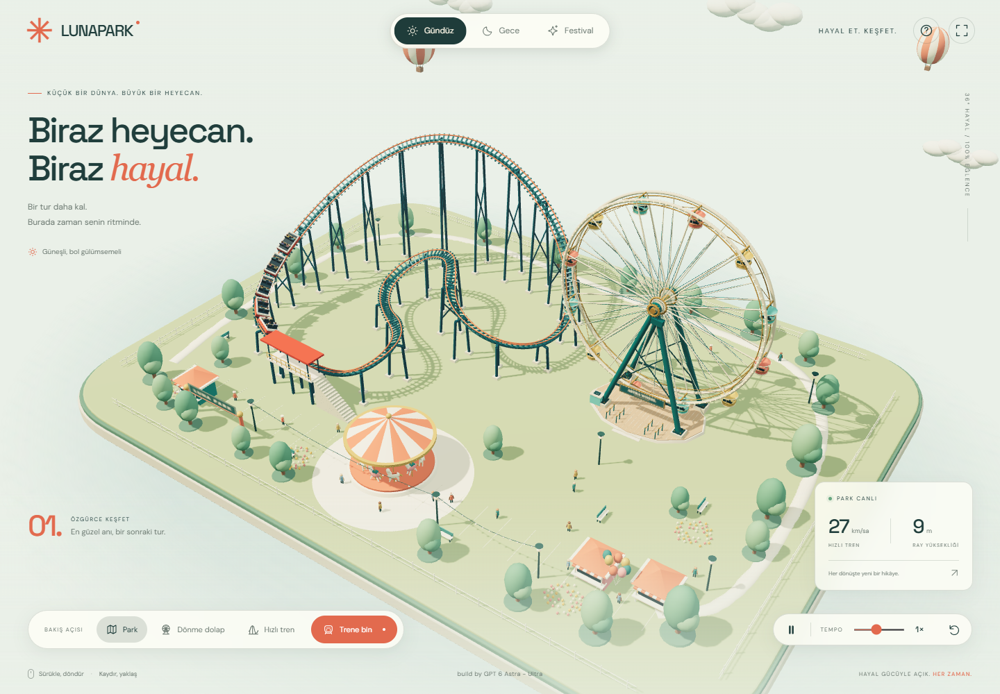

# LUNA PARK

**Biraz heyecan. Biraz hayal.** Tarayıcında dolaşabileceğin, tüm görselleri kodla oluşturulmuş bir 3D lunapark.

**build by GPT 6 Astra - Ultra**



[Tek HTML dosyasını indir](https://github.com/umutseve4/astra-lunapark/releases/download/v1.0.0/luna-park.html)

## Aç ve keşfet

[`index.html`](index.html) dosyasını indirip Chrome, Edge, Firefox veya Safari gibi güncel bir tarayıcıda aç. Sunucu, kurulum veya internet bağlantısı gerekmez. Three.js, yazı tipleri, arayüz ve tüm sahne tek dosyanın içindedir. WebGL desteği gerekir.

- **Gündüz:** sıcak güneş, yumuşak gölgeler ve pastel renkler.
- **Gece:** yıldızlı gökyüzü, aydınlatılmış kabinler ve park ışıkları.
- **Festival:** mor akşam göğü ve sahne boyunca yağan 680 renkli konfeti.
- **Dört kamera:** genel park, dönme dolap, hızlı tren ve trenin ön koltuğu.
- **Zaman kontrolü:** duraklatma ve 0,25×–2× arasında ortak simülasyon temposu.

Fareyle sürükleyerek döndür, tekerlekle yaklaş. Dokunmatik ekranda bir parmakla döndür, iki parmakla yakınlaştır. `Boşluk` duraklatır, `1` / `2` / `3` ortamı değiştirir, `R` genel görünüme döner. Hareket azaltma tercihi açık olduğunda park duraklatılmış başlar.

## Hareket nasıl çalışıyor?

**Dönme dolap:** iki taşıyıcı halka, bağlı jant telleri, sabit aks, A biçimli destekler, motor ve 12 ayrı kabin. Her kabin, dairesel hareketin merkezcil ve teğetsel ivmelerini alan, yerçekimi ve sönümleme altında çalışan bağımsız bir sarkaçtır. Kabinler tekerlekle birlikte baş aşağı dönmez.

**Hızlı tren:** periyodik, C² sürekliliğe sahip B-spline ray, metre cinsinden yay uzunluğu tablosuyla örneklenir. Rayın iki kolu virajlarda sabit açıklığı korur. Beş vagonun ön ve arka bogileri, sabit dingil mesafesini koruyacak şekilde ray üzerinde çözülür. Vagonlar arasında sabit uzunlukta mafsallı bağlantılar hesaplanır. Viraj yatışı, yerçekimi, sürtünme, kaldırma motoru, istasyon hız sınırı ve ilerideki eğriliğe göre frenleme birlikte çalışır. Bu, oyun için tasarlanmış bir hareket modelidir; mühendislik veya güvenlik sertifikasyonu amaçlamaz.

Ana döngü 120 Hz sabit adım kullanır. Tempo değişikliği bütün parkın simülasyon zamanını birlikte ölçekler. Sekme arka plana geçtiğinde zaman birikmez.

## Kaynak ve derleme

`index.html` doğrudan kullanıma hazırdır. Kaynakları değiştirdiğinde Python 3 ile yeniden oluştur:

```sh
python build.py
```

| Dosya | İşlev |
| --- | --- |
| `src/main.js` | Park, ışıklar, kameralar, kontroller ve zaman döngüsü |
| `src/coaster.js` | Ray geometrisi, vagon bağlantıları ve tren hareketi |
| `src/ferris.js` | Dönme dolap ve sarkaç dinamikleri |
| `src/batch.js` | Sabit geometrileri birleştirerek çizim yükünü azaltır |
| `src/style.css` | Masaüstü ve mobil arayüz |
| `src/index.template.html` | HTML arayüz şablonu |
| `build.py` | Bütün kaynakları tek HTML'e gömer |

## Doğrulama

```sh
python -m pip install playwright pillow
python tests/browser_smoke.py
```

Test varsayılan olarak Windows'taki kurulu Chrome'u kullanır; farklı sistemlerde `--chrome /tarayicinin/yolu` verilebilir. Gerçek WebGL çıktısını, çevrimdışı açılışı, JavaScript hatalarını, modları, konfeti etkinliğini, kamera takibini, duraklatmayı ve mobil arayüzü kontrol eder. Ray açıklığı, bağlantı uzunluğu, dingil mesafesi, çerçeve sürekliliği ve kabin zemin açıklığı ayrıca sayısal olarak doğrulanır. Ekran görüntüleri ile sonuçlar `tests/artifacts/` altında oluşur.

## Lisanslar

Proje kaynakları MIT lisanslıdır. Three.js 0.160.1 MIT; DM Sans ve Space Grotesk SIL Open Font License 1.1 lisanslıdır. Özgün lisans metinleri `vendor/` altında ve tek HTML'in başında bulunur. Haricî resim, model veya çalışma anında CDN isteği kullanılmaz.
